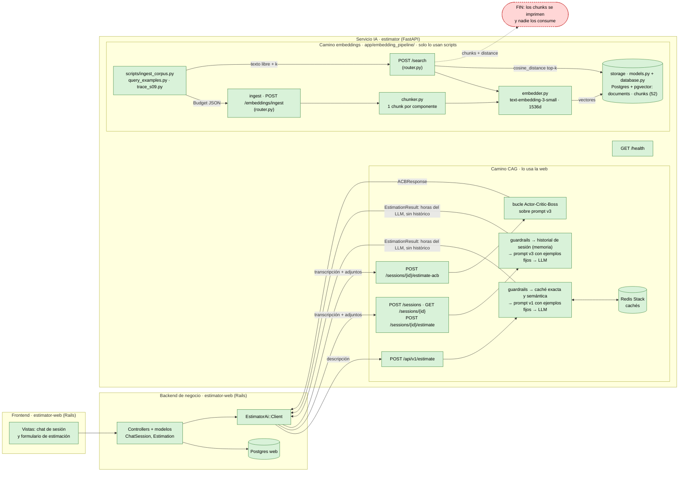

# Diagnóstico arquitectónico — Sesión 09 (pre-work)

> Estado del servicio IA al cerrar la sesión 08, trace de una transcripción real y propuesta de
> evolución. Las salidas crudas completas están en `odd/s09/`.

---

## 1. Diagrama de la arquitectura actual

El frontend y el backend de negocio son `estimator-web`, la app Rails de la sesión 6 del repo del curso. Este repo no la contiene, pero su `EstimatorAi::Client` llama a rutas que nuestro servicio expone tal cual. En el servicio IA, la ingesta vive en `app/embedding_pipeline/router.py` junto con el corpus `data/budgets_sample.json`, y el almacenamiento en `app/embedding_pipeline/models.py` y `database.py`.



**Leyenda:** en verde, lo implementado. En rojo, el punto donde termina el flujo.

**Lectura:** el servicio tiene dos caminos que no se tocan.
- Por el camino CAG, la web envía una transcripción y recibe una estimación. Pero en los tres endpoints el LLM estima solo con su conocimiento y con los ejemplos fijos de `examples.j2`, sin presupuestos históricos. La caché de Redis solo la usa `/api/v1/estimate`, y el historial de sesiones vive en memoria.
- Por el camino de embeddings, los presupuestos históricos están vectorizados y `/search` los recupera. Pero ningún componente usa lo recuperado.

Si llega una transcripción, el flujo se corta en `/search`: devuelve chunks y ahí acaba.

---

## 2. Trace anotado de `02_ambiguous.txt`

Entorno: `docker compose up -d postgres estimator`, con los 15 presupuestos y 52 chunks de la sesión 08 ya ingeridos. El script cliente `scripts/trace_s09.py` lee la transcripción por stdin, porque `examples/` no está montado en el contenedor.

```bash
curl -s localhost:8000/health
# {"status":"healthy","version":"0.1.0","environment":"development"}

docker compose exec -T postgres psql -U estimator -d estimator \
  -c "select count(*) chunks, count(distinct document_id) docs from chunks;"
#  chunks | docs
#      52 |   15
```

### Paso 1 — Embeber la transcripción completa

Ningún endpoint devuelve el vector: `/search` embebe la query internamente. Por eso este paso usa el mismo módulo que `/search`, `OpenAIEmbedder.embed_one` de `app/embedding_pipeline/embedder.py`.

```bash
docker compose run --rm -T estimator python scripts/trace_s09.py \
  < examples/transcripts/02_ambiguous.txt > odd/s09/trace_02_ambiguous.txt
```

```json
{
  "dimension": 1536,
  "l2_norm": 0.9996907476252158,
  "first_component": 0.00623321533203125,
  "last_component": 0.019012451171875
}
```

**Comentario:** el vector tiene 1536 dimensiones y norma 1, como todos los de `text-embedding-3-small`. Representa la conversación entera (890 tokens): tienda gourmet, venta online, fidelización, panel, pago, emails, y también los saludos, la sobrina, el primo de Francia y los timestamps. Es un único punto medio de todo eso, mientras que cada chunk del corpus describe un solo componente en unos 75 tokens.

### Paso 2 — Búsqueda semántica (top 5)

Es el mismo comando del paso 1: el script hace a continuación `POST /search` con `{"query": <transcripción completa>, "k": 5}`. Esta es la respuesta cruda, con el campo `query` (el eco de la transcripción entera) abreviado. El JSON completo está en `odd/s09/trace_02_ambiguous.txt`.

```json
{
  "query": "Reunión exploratoria — sin título claro todavía\nCliente: Rubén Castaño (gerente, Casa Cast… [890 tokens, abreviado]",
  "k": 5,
  "search_time_ms": 624.76,
  "results": [
    {
      "chunk_id": 16,
      "document_id": 5,
      "chunk_type": "component",
      "content": "[Project: Headless e-commerce storefront with personalized recommendations]\n[Client sector: ecommerce | Year: 2024 | Main tech: node]\n\nComponent: Product catalog API\nDescription: GraphQL catalog API with faceted search, inventory availability and multi-currency pricing backed by Elasticsearch.\nTech stack: node, graphql, elasticsearch\nComplexity: medium\nEstimated hours: 150",
      "distance": 0.6082955268052963,
      "metadata": {
        "year": 2024,
        "budget_id": "BUD-2024-005",
        "chunk_key": "BUD-2024-005::CATALOG-001",
        "complexity": "medium",
        "token_count": 76,
        "component_id": "CATALOG-001",
        "client_sector": "ecommerce",
        "estimated_hours": 150,
        "main_technology": "node"
      }
    },
    {
      "chunk_id": 17,
      "document_id": 5,
      "chunk_type": "component",
      "content": "[Project: Headless e-commerce storefront with personalized recommendations]\n[Client sector: ecommerce | Year: 2024 | Main tech: node]\n\nComponent: Cart and checkout service\nDescription: Stateless cart service with promotion engine, tax calculation and a checkout orchestration that integrates the payment provider.\nTech stack: node, redis, postgresql\nComplexity: high\nEstimated hours: 140",
      "distance": 0.613812936224204,
      "metadata": {
        "year": 2024,
        "budget_id": "BUD-2024-005",
        "chunk_key": "BUD-2024-005::CART-002",
        "complexity": "high",
        "token_count": 78,
        "component_id": "CART-002",
        "client_sector": "ecommerce",
        "estimated_hours": 140,
        "main_technology": "node"
      }
    },
    {
      "chunk_id": 18,
      "document_id": 5,
      "chunk_type": "component",
      "content": "[Project: Headless e-commerce storefront with personalized recommendations]\n[Client sector: ecommerce | Year: 2024 | Main tech: node]\n\nComponent: Personalized recommendations\nDescription: Collaborative-filtering recommendations served from a feature store and exposed as a low-latency API for product and cart pages.\nTech stack: node, redis\nComplexity: medium\nEstimated hours: 110",
      "distance": 0.6372392687033226,
      "metadata": {
        "year": 2024,
        "budget_id": "BUD-2024-005",
        "chunk_key": "BUD-2024-005::RECO-003",
        "complexity": "medium",
        "token_count": 78,
        "component_id": "RECO-003",
        "client_sector": "ecommerce",
        "estimated_hours": 110,
        "main_technology": "node"
      }
    },
    {
      "chunk_id": 19,
      "document_id": 5,
      "chunk_type": "component",
      "content": "[Project: Headless e-commerce storefront with personalized recommendations]\n[Client sector: ecommerce | Year: 2024 | Main tech: node]\n\nComponent: Storefront PWA\nDescription: Progressive web app storefront consuming the headless APIs with server-side rendering for SEO.\nTech stack: next_js, react\nComplexity: low\nEstimated hours: 60",
      "distance": 0.6387927424424642,
      "metadata": {
        "year": 2024,
        "budget_id": "BUD-2024-005",
        "chunk_key": "BUD-2024-005::STORE-004",
        "complexity": "low",
        "token_count": 72,
        "component_id": "STORE-004",
        "client_sector": "ecommerce",
        "estimated_hours": 60,
        "main_technology": "node"
      }
    },
    {
      "chunk_id": 27,
      "document_id": 8,
      "chunk_type": "component",
      "content": "[Project: Fashion returns management and resale portal]\n[Client sector: ecommerce | Year: 2023 | Main tech: dotnet]\n\nComponent: Returns portal\nDescription: Self-service returns portal with label generation, reason capture and automatic restock or resale routing.\nTech stack: dotnet, sqlserver\nComplexity: medium\nEstimated hours: 140",
      "distance": 0.6443925356419238,
      "metadata": {
        "year": 2023,
        "budget_id": "BUD-2024-008",
        "chunk_key": "BUD-2024-008::RET-001",
        "complexity": "medium",
        "token_count": 72,
        "component_id": "RET-001",
        "client_sector": "ecommerce",
        "estimated_hours": 140,
        "main_technology": "dotnet"
      }
    }
  ]
}
```

### Paso 3 — Lectura de los chunks devueltos

Lo que pide el cliente: (1) tienda online, (2) fidelización con puntos o club, (3) panel con pedidos, ventas y stock, (4) pago con tarjeta sin abandonos de carrito y (5) email de confirmación del pedido.

| # | Chunk | Presupuesto · sector | Distancia | ¿Relevante? |
|---|---|---|---|---|
| 1 | Product catalog API (150 h) | BUD-2024-005 · ecommerce | 0,6083 | **Sí.** Cubre la necesidad (1), aunque con GraphQL, Elasticsearch y multidivisa: sobredimensionado para una tienda gourmet. |
| 2 | Cart and checkout service (140 h) | BUD-2024-005 · ecommerce | 0,6138 | **Sí.** Cubre las necesidades (1) y (4). Es la mejor coincidencia del top 5. |
| 3 | Personalized recommendations (110 h) | BUD-2024-005 · ecommerce | 0,6372 | **No.** El cliente no pide recomendaciones. Entra porque comparte cabecera de proyecto con 1 y 2. |
| 4 | Storefront PWA (60 h) | BUD-2024-005 · ecommerce | 0,6388 | **Sí.** Es la parte visible de la necesidad (1). |
| 5 | Returns portal (140 h) | BUD-2024-008 · ecommerce | 0,6444 | **No.** El cliente no menciona devoluciones. Es "ecommerce genérico". |

**Valoración honesta:** el sector es correcto y 3 de 5 resultados son útiles, así que el retrieval funciona para el tema dominante. Pero cubre 2 de las 5 necesidades. No aparecen la fidelización, el panel ni los emails, aunque el corpus tiene candidatos para dos de ellas: `Push and email notifications` (BUD-001), `Merchant dashboard` (BUD-003), `Operations KPI reporting` (BUD-014) y `Real-time inventory sync` (BUD-007). Además, las distancias están todas por encima de 0,6 y en una franja de solo 0,036.

### Contraste: `01_clear.txt` y `03_hard.txt` (solo `/search`)

```bash
docker compose run --rm -T estimator python scripts/trace_s09.py --search-only \
  < examples/transcripts/01_clear.txt > odd/s09/search_01_clear.txt
docker compose run --rm -T estimator python scripts/trace_s09.py --search-only \
  < examples/transcripts/03_hard.txt > odd/s09/search_03_hard.txt
```

| Transcripción | Top 5 (presupuesto · distancia) | Observación |
|---|---|---|
| 01, fintech clara (599 tokens) | PSD2 connectors (001 · 0,415), OAuth 2.0 backend (001 · 0,428), **Transaction ledger** (001 · 0,443), **Push and email notifications** (001 · 0,468), Payment gateway core (003 · 0,484) | Distancias mucho menores que en la 02. El ledger que la clienta aplaza explícitamente a "fase dos" sale tercero, y las notificaciones, que no pide, cuartas. |
| 03, clínica indecisa (736 tokens) | **Telemedicine video sessions** (009 · 0,518), Appointment scheduling (009 · 0,546), FHIR integration (009 · 0,583), Consent and audit (009 · 0,595), Care team dashboard (010 · 0,616) | Recupera bien el sector y el presupuesto gemelo (BUD-009). Pero la videoconsulta, que la clienta no ha decidido, sale primera por delante de la agenda, que era lo prioritario. |

---

## 3. Diagnóstico: cinco fallos identificados

### Fallo 1 — Un único vector para varias necesidades: solo se recupera la dominante
- **Problema observado:** la 02 pide cinco cosas y 4 de los 5 chunks salen de un solo presupuesto (BUD-005, "tienda online"). Ninguno cubre el panel ni los emails, aunque el corpus tiene `Merchant dashboard`, `Operations KPI reporting` y `Push and email notifications`.
- **Causa probable:** la transcripción entera se embebe en un solo vector y se hace una sola búsqueda. El vector es la media de varias necesidades y queda más cerca del tema que más ocupa.
- **Propuesta de solución:** antes del retrieval, una etapa que convierta la transcripción en una lista de necesidades explícitas, y una búsqueda por cada necesidad en lugar de una por transcripción.

### Fallo 2 — El retrieval no distingue alcance confirmado, aplazado o en duda
- **Problema observado:** en la 01, el `Transaction ledger` (0,443) sale tercero aunque la clienta dice "eso es fase dos; ahora céntrate en autenticación y PSD2". En la 03, `Telemedicine video sessions` sale primero (0,518) aunque la clienta dice "no lo tengo decidido".
- **Causa probable:** el embedding captura de qué se habla, no si se pide. Mencionar algo para descartarlo lo acerca tanto como pedirlo, y ningún componente lee la intención.
- **Propuesta de solución:** que la extracción de necesidades del fallo 1 etiquete cada una como confirmada, aplazada o en duda. Las confirmadas forman la estimación base; las aplazadas y en duda, escenarios aparte.

### Fallo 3 — Distancias comprimidas y sin umbral: siempre devuelve 5, sean buenos o no
- **Problema observado:** en la 02, los cinco resultados van de 0,608 a 0,644, una franja de 0,036, y `Returns portal` entra con 0,644 sin tener relación con el cliente. En la 01 el mejor resultado está en 0,415. Es decir, la 02 obtiene peores coincidencias, pero la respuesta tiene la misma forma.
- **Causa probable:** una query de 890 tokens con ruido conversacional (saludos, timestamps, anécdotas familiares) se compara con chunks de unos 75 tokens. Además, `/search` solo admite `k` y siempre devuelve exactamente `k` resultados.
- **Propuesta de solución:** condensar la query (la salida del fallo 1 ya son frases cortas sin ruido), aplicar un umbral de distancia calibrado con el corpus y devolver menos de `k` resultados, o ninguno, cuando nada lo supera.

### Fallo 4 — Los huecos del corpus son silenciosos
- **Problema observado:** el cliente pide un programa de fidelización con puntos o club. Ningún presupuesto del corpus tiene un componente parecido (comprobado en `data/budgets_sample.json`), y la respuesta de `/search` no lo indica de ninguna forma.
- **Causa probable:** el sistema solo responde "estos son los más parecidos", nunca "esto no lo tengo". No hay ningún punto que compare lo pedido con lo recuperado.
- **Propuesta de solución:** un informe de cobertura por necesidad (cubierta, con su referencia, o sin referencia histórica) que llegue a la generación. Así, lo que no tenga referencia se estima marcado como tal y no se omite ni se mezcla con lo respaldado.

### Fallo 5 — La evidencia recuperada no llega a la estimación
- **Problema observado:** cada chunk trae `estimated_hours` (150, 140, 110, 60 y 140 en el trace) y `complexity`, pero el trace termina en una respuesta JSON. El estimador que usa la web (`/sessions/{id}/estimate`) genera horas con el prompt v3 y unos ejemplos fijos (`examples.j2`), sin llamar a `/search`.
- **Causa probable:** el camino CAG (sesiones 2 a 6) y el de embeddings (sesiones 7 y 8) se construyeron por separado y no hay ninguna pieza que los una (sección 1).
- **Propuesta de solución:** una etapa que monte el contexto de la estimación con las referencias recuperadas por necesidad (componente, horas, complejidad y presupuesto de origen), y un estimador que lo reciba y cite qué referencia usa en cada línea.

### Otros
- **Granularidad sin agrupación por presupuesto:** 4 de 5 chunks son de BUD-005, pero la respuesta no lo agrupa ni da el total del proyecto. Para estimar "un proyecto parecido" habría que reconstruirlo a mano.
- **Sobredimensionamiento de las referencias:** el catálogo recuperado incluye Elasticsearch y multidivisa, y la 02 es una tienda pequeña. Copiar sus 150 h sin ajuste inflaría la estimación. No hay ninguna noción de escala del cliente.
- **Idioma, hipótesis sin confirmar:** el corpus está en inglés y las transcripciones en español. La 01 en español obtiene distancias (0,415) parecidas a las de las queries en inglés de la sesión 08 (0,41 en `output_examples.txt`), así que el idioma no parece ser la causa principal de lo que pasa con la 02. Pero la comparación es débil, porque aquellas queries eran frases cortas y dirigidas. Habría que medirlo con la misma query en los dos idiomas.
- **`/search` solo acepta texto:** no admite un vector, así que el vector del paso 1 no se puede reutilizar y la misma transcripción se embebe dos veces.

---

## 4. Propuesta de evolución arquitectónica

```mermaid
flowchart LR
  subgraph FE["Frontend · estimator-web"]
    UI["Vistas: chat de sesión<br/>+ NUEVO: necesidades, cobertura y escenarios"]
  end

  subgraph BE["Backend de negocio · estimator-web"]
    CTRL["Controllers + modelos"]
    CLI["EstimatorAi::Client"]
  end

  subgraph IA["Servicio IA · estimator"]
    EP1["POST /sessions/{id}/estimate · /estimate-acb · /api/v1/estimate<br/>(mismos contratos)"]
    NEEDS["NUEVO · Extractor de necesidades<br/>transcripción → necesidades + estado de alcance"]
    RET["NUEVO · Retriever por necesidad<br/>1 búsqueda por necesidad + umbral"]
    COV["NUEVO · Informe de cobertura<br/>cubierta / sin referencia"]
    CTX["NUEVO · Ensamblador de contexto<br/>referencias por necesidad: componente, horas, presupuesto"]
    EST["MODIFICADO · Estimador (existente)<br/>prompt con referencias en vez de ejemplos fijos"]
    SEARCH["POST /search + embedder (existentes)"]
    PG[("Postgres + pgvector")]
  end

  UI --> CTRL --> CLI
  CLI -- "transcripción" --> EP1
  EP1 --> NEEDS
  NEEDS -- "need[]: texto corto + confirmada/aplazada/en duda" --> RET
  RET -- "1 query por need" --> SEARCH --> PG
  RET -- "chunks con distancia ≤ umbral, por need" --> COV
  COV -- "need → refs o sin referencia" --> CTX
  CTX -- "contexto: base + escenarios + huecos" --> EST
  EST -- "estimación con referencias citadas<br/>+ partidas sin referencia marcadas" --> CLI

  classDef impl fill:#d9f2d9,stroke:#2e7d32,color:#000
  classDef new fill:#ffe0b2,stroke:#e65100,color:#000,stroke-width:2px
  class CTRL,CLI,EP1,SEARCH,PG impl
  class NEEDS,RET,COV,CTX,UI,EST new
```



**Leyenda:** en verde, lo que ya existe sin cambios. En naranja, lo nuevo o modificado. La interfaz de la web pasa a mostrar las necesidades detectadas, la cobertura y los escenarios.

El **extractor de necesidades** convierte la transcripción en frases cortas sin ruido, cada una con su estado
de alcance (fallos 1, 2 y 3). El **retriever por necesidad** lanza una búsqueda por frase sobre el `/search`
actual y descarta lo que supera el umbral (fallo 3). El **informe de cobertura** cruza necesidades con
resultados y deja explícitos los huecos, como la fidelización (fallo 4). El **ensamblador de contexto**
entrega al estimador existente un bloque con referencias y horas por necesidad, separado en base, escenarios
y huecos (fallo 5). Entre módulos fluye `need[]`, luego `need → chunks[]` y luego un contexto estructurado.
La pieza más crítica es el **extractor de necesidades**: sin él, conectar el retrieval a la generación solo
metería en el prompt los cuatro componentes de BUD-005. Todo lo demás depende de que la query represente lo
que el cliente pide de verdad.
