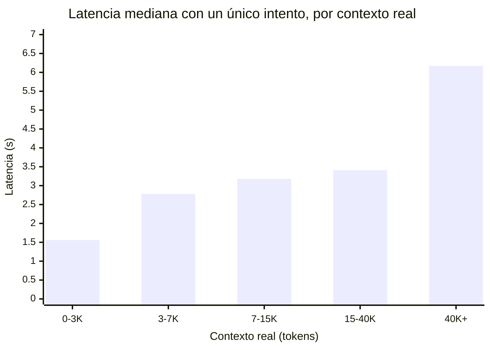
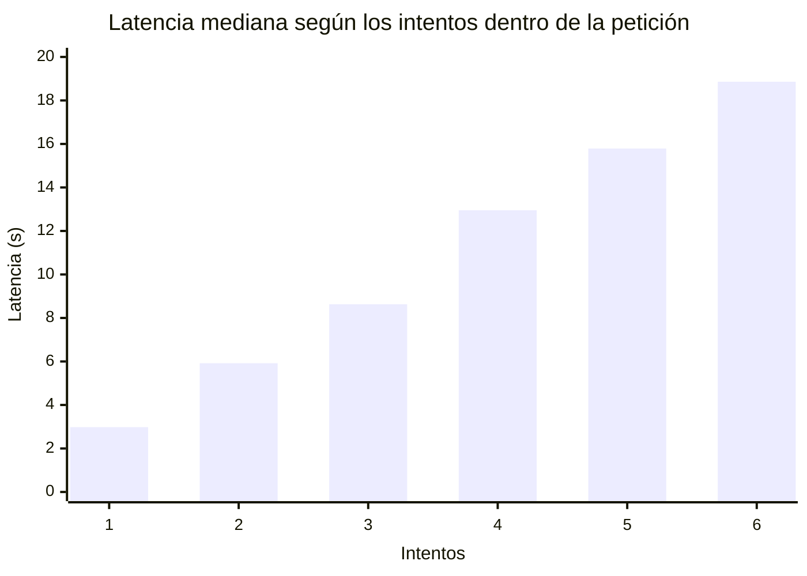
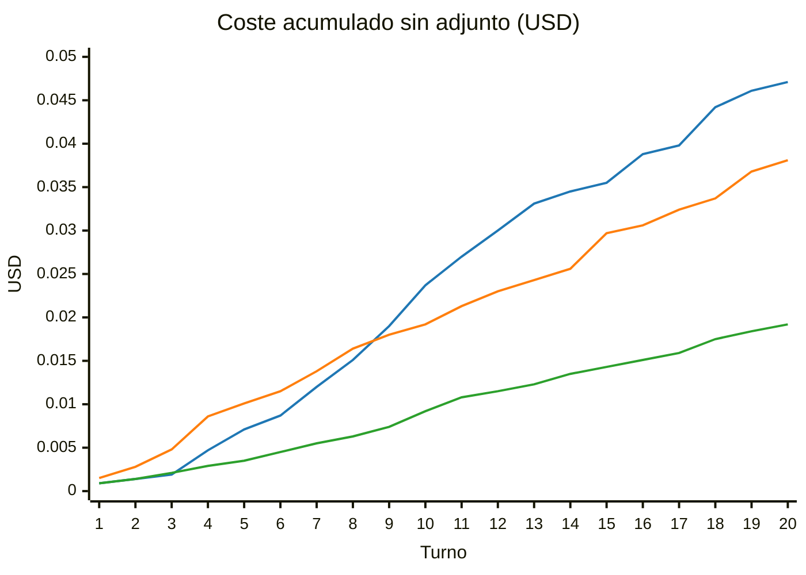
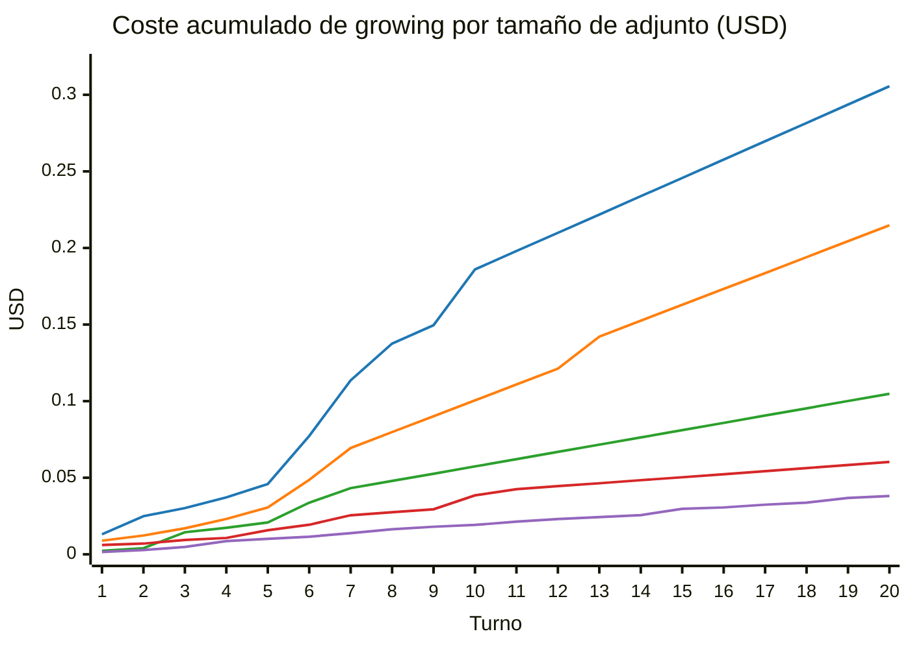
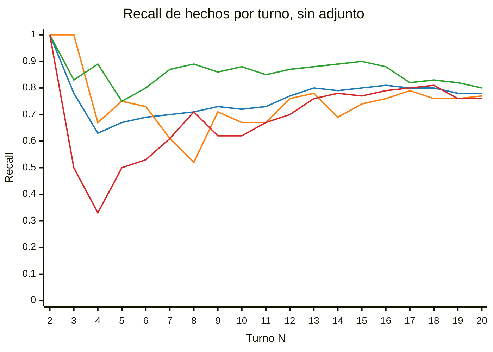
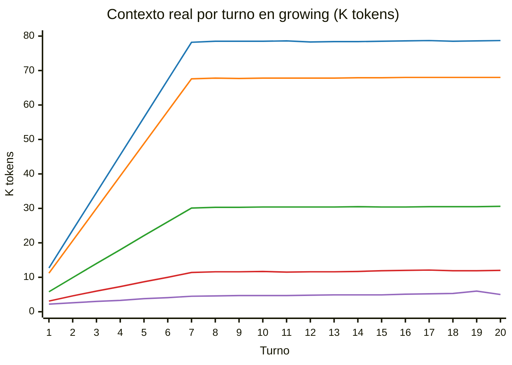

# Prueba de carga del CAG del estimador de proyectos

**Datos:** `evals/stress/results.csv` (338 filas, 260 turnos válidos)
**Modelo:** `gpt-4o-mini`
**Fecha de ejecución:** 11 de octubre de 2026

---

## Resumen ejecutivo

Este informe mide cómo se comporta el estimador conversacional cuando la
conversación se alarga y cuando el usuario adjunta documentos grandes. El
objetivo es fijar una línea base cuantitativa del enfoque actual (CAG, todo
el contexto en el prompt) antes de compararlo con un enfoque RAG.

Se ejecutaron 13 conversaciones de 20 turnos contra el servicio real. Las
conclusiones principales son:

- **La memoria se degrada a partir del turno 7.** En ese punto la ventana
  de conversación (6 turnos) se llena y los hechos antiguos pasan a
  depender de un resumen.
  - El sistema conserva entre el 70 % y el 81 % de los hechos ya
    introducidos.
  - Nunca promueve un hecho a "ancla".
  - No retira los valores que el usuario corrige.
- **Los documentos adjuntos dominan el contexto.** El documento se reenvía
  en cada turno.
  - Con un PDF de 100 KB, el contexto por turno pasa de 12,7 K a 78,5 K
    tokens en 7 turnos, unas 16 veces el de una conversación sin adjunto.
  - La conversación completa cuesta 8 veces más.
- **El factor que más pesa en coste y latencia es la validación de la
  respuesta, no el tamaño del contexto.** Cuando la estimación generada no
  es coherente (las fases no suman el total), el sistema vuelve a pedirla al
  modelo.
  - Esto ocurrió en el 39 % de los turnos.
  - Supone alrededor del 71 % del gasto total.
  - Cada reintento añade unos 3 segundos.
  - 76 de las 338 peticiones (22 %) fallaron tras agotar los reintentos y
    se repitieron.

| Indicador | Sin adjunto (media de los 3 escenarios) | Con adjunto de 100 KB |
|-----------|----------------------------------------:|----------------------:|
| Latencia mediana / P95 | 3,4 s / 13,8 s | 7,2 s / 16,4 s |
| Turnos dentro de 8 s | 83 % | 55 % |
| Contexto real por turno (desde el turno 8) | ~4,7 K tokens | ~78,5 K tokens |
| Coste de una conversación de 20 turnos | $0,035 | $0,306 |
| Recall de hechos en el turno 20 | 0,78 | 0,84 (1 sesión) |
| Acierto de caché (exacta / semántica) | 0 % / 0 % | 0 % / 0 % |

---

## 1. Sistema evaluado

El estimador recibe una conversación en varios turnos sobre un proyecto de
software y devuelve una estimación estructurada: fases, coste y duración.
Su memoria conversacional (CAG) combina cuatro piezas:

| Pieza | Función |
|-------|---------|
| Ventana deslizante | Los últimos 6 turnos completos se envían al modelo tal cual. |
| Resumen acumulado | Cuando un turno sale de la ventana, un resumidor lo incorpora a un resumen de texto. |
| Anclas | Turnos marcados como críticos que deberían conservarse siempre. |
| Metadatos del proyecto | Campos extraídos en cada turno: nombre, tamaño del equipo, tecnologías y alcance. |

La respuesta del modelo se valida con un esquema estricto. Si la suma de
las fases no coincide con el total, la librería `instructor` reintenta la
llamada, hasta 6 veces, dentro de la misma petición. Si los 6 intentos
fallan, el servicio responde con un error 502.

## 2. Metodología

**Escenarios.** Cada conversación tiene 20 turnos escritos de antemano:

| Escenario | Qué simula | Qué se observa |
|-----------|------------|----------------|
| growing | Un proyecto al que se añaden requisitos turno a turno (SSO, multi-tenant, auditoría…). | Crecimiento del coste y conservación de los hechos. |
| pivot | En el turno 5 el cliente cambia de tecnología: de React Native a Flutter. | Si la memoria sustituye el valor antiguo. |
| contradiction | En el turno 8 el cliente corrige el presupuesto: de 30 000 € a 80 000 €. | Si la memoria conserva el valor correcto. |

**Adjuntos.** Se generaron PDFs sintéticos de 5, 20, 50 y 100 KB y se
adjuntaron en cada turno del escenario growing. El extractor corta cada
adjunto en 60 000 caracteres, de modo que el caso de 100 KB mide en
realidad un adjunto truncado a unos 60 KB de texto.

**Matriz ejecutada.** Se ejecutó una matriz reducida, de 260 turnos, en
lugar de la completa (5 tamaños × 3 escenarios × 3 repeticiones = 900
turnos):

- Los tres escenarios sin adjunto, con 3 repeticiones, para medir la
  memoria.
- El escenario growing con cada tamaño de adjunto, con 1 repetición, para
  medir latencia y coste.

Los escenarios pivot y contradiction no se repitieron con adjunto, porque
el adjunto es el mismo en los tres escenarios y no aporta información
nueva sobre la memoria.

**Métricas.**

- **Latencia:** tiempo de la llamada principal al modelo, con un
  presupuesto de 8 s.
- **Coste:** coste de la llamada principal en USD, con un presupuesto de
  $0,02 por turno.
- **Drift (`MemoryDriftMetric`):** si el nombre del proyecto, introducido en
  el turno 1, sigue presente en el resumen, las anclas o los metadatos.
- **Recall de hechos:** la proporción de todos los hechos introducidos hasta
  el turno N−1 que siguen presentes en el resumen, las anclas o los
  metadatos.
- **Contexto real:** los tokens de entrada de un solo intento. El valor que
  devuelve el proveedor suma todos los reintentos; el Anexo B explica cómo
  se separan.

Los turnos que fallaron se repitieron, hasta 3 veces (5 en algunos casos).
Las conversaciones que no pasaron del primer turno se volvieron a ejecutar.
Las curvas usan solo turnos válidos de conversaciones completas.

---

## 3. Resultados

### 3.1 Latencia frente al tamaño del contexto

Solo se incluyen los 159 turnos resueltos en un único intento, para aislar
el efecto del contexto. La tabla equivalente con los `tokens_in` brutos
está en el Anexo B.



| Contexto real | Mediana (ms) | P95 (ms) | Turnos |
|---------------|-------------:|---------:|-------:|
| 0–2 999       |  1560 |  2878 | 17 |
| 3 000–6 999   |  2781 |  3877 | 84 |
| 7 000–14 999  |  3177 |  3649 | 13 |
| 15 000–39 999 |  3407 |  4159 | 19 |
| 40 000 o más  |  6172 | 17297 | 26 |

Por debajo de 40 K tokens, el contexto apenas mueve la latencia: la
mediana se mantiene en torno a 3 s. Lo que sí la mueve es el número de
intentos:



| Intentos | Mediana (ms) | P95 (ms) | Turnos |
|---------:|-------------:|---------:|-------:|
| 1 |  2975 |  9485 | 159 |
| 2 |  5924 |  7842 |  59 |
| 3 |  8625 | 11973 |  19 |
| 4 | 12954 | 17494 |  14 |
| 5 | 15786 | 20201 |   8 |
| 6 | 18864 |     — |   1 |

### 3.2 Coste acumulado por turno

Coste de la llamada principal, acumulado turno a turno. Incluye los
reintentos de los turnos válidos, pero no las peticiones que acabaron en
error (su coste está en el Anexo A). Los datos sin adjunto son la media de
3 repeticiones; con adjunto, una sola conversación.

Sin adjunto, por escenario. De arriba abajo en el turno 20: contradiction
(azul), growing (naranja) y pivot (verde).



Escenario growing, por tamaño de adjunto. De arriba abajo: 100 KB (azul),
50 KB (naranja), 20 KB (verde), 5 KB (rojo) y sin adjunto (morado).



| Turno | growing | pivot | contradiction | growing 5 KB | growing 20 KB | growing 50 KB | growing 100 KB |
|------:|--------:|------:|--------------:|-------------:|--------------:|--------------:|---------------:|
|  1 | 0,0015 | 0,0009 | 0,0009 | 0,0061 | 0,0023 | 0,0089 | 0,0131 |
|  5 | 0,0101 | 0,0035 | 0,0071 | 0,0157 | 0,0208 | 0,0306 | 0,0459 |
| 10 | 0,0192 | 0,0092 | 0,0237 | 0,0385 | 0,0574 | 0,1005 | 0,1860 |
| 15 | 0,0297 | 0,0143 | 0,0355 | 0,0503 | 0,0811 | 0,1629 | 0,2457 |
| 20 | 0,0381 | 0,0192 | 0,0471 | 0,0603 | 0,1048 | 0,2148 | 0,3056 |

Desde el turno 8 el coste crece de forma lineal: unos $0,002 por turno sin
adjunto y unos $0,012 con 100 KB. Los escalones de la curva, por ejemplo en
los turnos 6, 7 y 10 con 100 KB, son turnos que necesitaron 2 o 3
intentos. Al final de la conversación, growing con 100 KB acumula 8 veces
el coste de growing sin adjunto.

### 3.3 Memoria frente a la longitud de la conversación

Conversaciones sin adjunto: 9 por turno (3 escenarios × 3 repeticiones).
Colores: media de los tres escenarios (azul), growing (naranja), pivot
(verde) y contradiction (rojo).



| Turno N | `MemoryDriftMetric` (%) | Recall medio | growing | pivot | contradiction |
|--------:|------------------------:|-------------:|--------:|------:|--------------:|
|  2 | 100 | 1,00 | 1,00 | 1,00 | 1,00 |
|  4 | 100 | 0,63 | 0,67 | 0,89 | 0,33 |
|  8 | 100 | 0,71 | 0,52 | 0,89 | 0,71 |
| 10 | 100 | 0,72 | 0,67 | 0,88 | 0,62 |
| 15 | 100 | 0,80 | 0,74 | 0,90 | 0,77 |
| 20 | 100 | 0,78 | 0,77 | 0,80 | 0,76 |

**Cómo leer esta curva.**

- **`MemoryDriftMetric` siempre vale 100 %.** El nombre del proyecto se
  guarda en un campo de metadatos que nunca se recorta. Por eso se añadió
  el recall de todos los hechos.
- **Hasta el turno 6 todavía no existe resumen.** El recall solo ve los
  metadatos, mientras que el modelo sigue teniendo esos hechos en la
  ventana. La caída de los turnos 3 a 6 refleja lo que el extractor de
  metadatos no captura, no un olvido del modelo.
- **Desde el turno 7 el recall sí mide lo que se pierde.** Ahí los hechos
  que salen de la ventana solo sobreviven en el resumen o en los metadatos.

**Correcciones del usuario.** El detalle completo está en el Anexo D.

- En pivot, React Native permanece en los metadatos junto a Flutter hasta
  el turno 20, en las 3 repeticiones.
- En contradiction, el resumen recoge el presupuesto antiguo en el turno 9
  y el nuevo solo hacia el turno 16.
- Una de las 3 conversaciones de contradiction termina con solo el valor
  antiguo.

---

## 4. Conclusiones: dónde empieza a romperse el CAG

**Párrafo 1 — dónde se rompe y qué lo domina.**

El CAG empieza a romperse en el turno 7, cuando la ventana de 6 turnos se
llena y la conversación antigua pasa a depender del resumen.

- **Memoria.** A partir de ese punto conserva entre el 70 % y el 81 % de
  los hechos (0,52 en el peor caso, en el turno 8 de growing). No crea
  anclas y no resuelve las correcciones: los metadatos acumulan el valor
  antiguo junto al nuevo, y el resumen tarda unos 8 turnos en reflejar el
  presupuesto corregido.
- **Coste y latencia.** La degradación dominante no es la memoria ni el
  tamaño del contexto, sino la validación de la respuesta:
  - el 39 % de los turnos necesitó reintentos;
  - las 76 peticiones que fallaron costaron más ($1,23) que los 260 turnos
    válidos ($1,00);
  - cada reintento añade unos 3 segundos.
- **Adjunto grande.** Con 100 KB el contexto del turno 7 multiplica por 6,2
  el del turno 1 (78,2 K frente a 12,7 K tokens), y solo el 55 % de los
  turnos queda dentro del presupuesto de 8 segundos.

**Párrafo 2 — cuándo está justificado pasar a RAG.**

El caso límite que justifica RAG es una conversación con un documento
grande:

- Con 100 KB, el 94 % del contexto son copias del adjunto que se reenvían
  en cada turno, y esas copias no mejoran el recall (0,84 frente a 0,74 sin
  adjunto).
- Recuperar unos 2 K tokens relevantes por turno dejaría el contexto en
  unos 7 K tokens. Con ese tamaño, la latencia medida es de unos 3 s por
  intento.
- El coste sería aproximadamente el de una conversación sin adjunto, a
  cambio de una pasada de embeddings al subir el documento y una búsqueda
  por turno.

El segundo argumento es la memoria: recuperar los turnos donde el usuario
cambió de tecnología o de presupuesto respondería mejor que un resumen que
conserva el valor antiguo.

**Una advertencia para esa comparación.** RAG reduce el contexto, pero no
los reintentos de validación, que en esta prueba son el mayor coste. Si la
comparación no los separa, atribuiría a RAG un ahorro que no le
corresponde.

---

## Anexos

- [Anexo A. Tablas completas por escenario y tamaño](#anexo-a-tablas-completas-por-escenario-y-tamaño)
- [Anexo B. Reintentos internos y estimación del contexto real](#anexo-b-reintentos-internos-y-estimación-del-contexto-real)
- [Anexo C. Contexto real por turno](#anexo-c-contexto-real-por-turno)
- [Anexo D. Correcciones del usuario: qué valor conserva la memoria](#anexo-d-correcciones-del-usuario-qué-valor-conserva-la-memoria)
- [Anexo E. Cambios en el código de referencia](#anexo-e-cambios-en-el-código-de-referencia)
- [Anexo F. Limitaciones](#anexo-f-limitaciones)
- [Anexo G. Reproducibilidad](#anexo-g-reproducibilidad)

### Anexo A. Tablas completas por escenario y tamaño

Una fila por combinación de escenario y tamaño de adjunto. Sin adjunto se
agregan 3 repeticiones (60 turnos); con adjunto, una conversación (20
turnos).

| Escenario | KB | Turnos | P50 ms | P95 ms | Coste total $ | Caché exacta | Caché semántica | Turnos ≤ 8 s | Drift % | Recall medio |
|-----------|---:|-------:|-------:|-------:|--------------:|-------------:|----------------:|-------------:|--------:|-------------:|
| growing       |   0 | 60 | 5344 | 13740 | 0,114 | 0 % | 0 % | 81,7 % | 100 | 0,74 |
| pivot         |   0 | 60 | 2646 |  6091 | 0,058 | 0 % | 0 % | 98,3 % | 100 | 0,86 |
| contradiction |   0 | 60 | 5401 | 18874 | 0,141 | 0 % | 0 % | 70,0 % | 100 | 0,69 |
| growing       |   5 | 20 | 3321 | 11183 | 0,060 | 0 % | 0 % | 80,0 % | 100 | 0,81 |
| growing       |  20 | 20 | 3489 |  9758 | 0,105 | 0 % | 0 % | 90,0 % | 100 | 0,80 |
| growing       |  50 | 20 | 7212 | 17402 | 0,215 | 0 % | 0 % | 65,0 % | 100 | 0,89 |
| growing       | 100 | 20 | 7213 | 16375 | 0,306 | 0 % | 0 % | 55,0 % | 100 | 0,84 |
| **Total**     |     |260 | 4007 | 15236 | 0,999 | 0 % | 0 % |        |     |      |

La caché no acierta nunca porque cada turno envía un texto nuevo. Solo los
casos de 50 KB (90 %) y 100 KB (80 %) tienen turnos por encima del
presupuesto de $0,02.

Desglose de reintentos y fallos:

| Escenario | KB | Turnos con reintentos | Intentos medios por turno | Contexto real (turno ≥ 8) | Peticiones fallidas | Coste de las fallidas $ | Coste con un intento por turno $ (est.) |
|-----------|---:|------:|-----:|-------:|---:|------:|------:|
| growing       |   0 | 55 % | 1,88 |  4,9 K | 22 | 0,188 | 0,051 |
| pivot         |   0 | 23 % | 1,25 |  4,4 K |  9 | 0,068 | 0,044 |
| contradiction |   0 | 55 % | 2,13 |  4,8 K | 16 | 0,152 | 0,049 |
| growing       |   5 | 35 % | 1,70 | 11,7 K |  6 | 0,088 | 0,035 |
| growing       |  20 | 20 % | 1,35 | 30,4 K |  8 | 0,106 | 0,082 |
| growing       |  50 | 20 % | 1,30 | 67,9 K | 11 | 0,393 | 0,178 |
| growing       | 100 | 30 % | 1,65 | 78,5 K |  4 | 0,235 | 0,204 |
| **Total**     |     | 39 % |      |        | 76 | 1,229 | 0,642 |

El gasto total de la llamada principal es de $2,24: $0,999 en turnos
válidos y $1,229 en peticiones fallidas. Con un único intento por turno,
los turnos válidos habrían costado unos $0,64. Los reintentos suponen por
tanto unos $1,59 (71 %).

### Anexo B. Reintentos internos y estimación del contexto real

**El problema.** Cuando la estimación no pasa la validación, `instructor`
la vuelve a pedir dentro de la misma petición. En cada reintento añade la
respuesta fallida y el error. El uso de tokens que devuelve es la suma de
todos los intentos (`update_total_usage` en `instructor/core/retry.py`).

Por tanto, en un turno con reintentos, `tokens_in`, `cost_usd` y
`latency_ms` acumulan entre 2 y 6 intentos. El coste sigue siendo el gasto
real, pero `tokens_in` deja de medir el tamaño del contexto. La columna
`attempt` del CSV no lo refleja: solo cuenta las peticiones repetidas tras
un error 502.

**Latencia frente a `tokens_in` bruto** (los 260 turnos válidos):

| `tokens_in` | Mediana (ms) | P95 (ms) | Turnos |
|-------------|-------------:|---------:|-------:|
| 1 000–2 999   | 1560 |  2878 | 17 |
| 3 000–6 999   | 2860 |  5760 | 96 |
| 7 000–14 999  | 5800 |  8228 | 57 |
| 15 000 o más  | 8360 | 17596 | 90 |

Con los datos brutos parece que la latencia crece con el contexto. En
realidad, los turnos con varios intentos caen en los tramos altos por la
suma de tokens, no por su contexto.

**Recuperación.** El script `evals/stress/annotate_attempts.py` lee el log
del servidor (`evals/stress/server.log`) y añade seis columnas al CSV, sin
modificar las 30 originales:

| Columna | Significado |
|---------|-------------|
| `internal_attempts_est` | Intentos de `instructor` dentro de la petición. |
| `tokens_in_first_attempt_est` | Tokens de entrada de un intento, es decir, el contexto real del turno. |
| `attempts_method` | Origen de los dos valores anteriores: `log`, `log_anchored` o `estimated`. |
| `tokens_in_log`, `tokens_out_log`, `cost_usd_log` | Uso real de las peticiones fallidas, según el log. |

**Calibración.** Cada petición fallida registra en el log sus 6 intentos
con el uso acumulado. A partir de las 76, el intento k consume
`b + (k−1)·α·o + (k−1)(k−2)/2·β·o` tokens de entrada, donde:

- `b` es el contexto del primer intento;
- `o` es la salida por intento (mediana de 305 tokens);
- α = 3,58 y β = 2,13.

**Métodos:**

- **`log` (76 filas de error).** Valor exacto, leído del log.
- **`log_anchored` (43 filas).** Turnos válidos que se repitieron tras un
  error. El contexto es exacto, porque coincide con el primer intento de la
  petición fallida del mismo turno. El número de intentos es el que mejor
  reproduce `tokens_in`.
- **`estimated` (219 filas).** Se elige el número de intentos que mejor
  encaja con dos referencias: una salida de unos 305 tokens por intento y
  el menor `tokens_in` de los turnos cercanos (±2) de la misma
  conversación.

**Validación.**

- Contra las 43 filas `log_anchored`, el método `estimated` acierta el
  número de intentos en 41.
- Los pesos de la puntuación (0,5 para el contexto y 1,0 para la salida) se
  ajustaron sobre esas mismas filas, así que la cifra es algo optimista.
  Usando solo la salida acierta en 36.
- Un recálculo independiente, escrito desde la especificación sin usar el
  script, reprodujo todos los valores.

### Anexo C. Contexto real por turno

Contexto real (en miles de tokens) del escenario growing por tamaño de
adjunto. De arriba abajo: 100 KB (azul), 50 KB (naranja), 20 KB (verde),
5 KB (rojo) y sin adjunto (morado). La ventana añade una copia del adjunto
por turno hasta el turno 7; después, el contexto se mantiene estable.



### Anexo D. Correcciones del usuario: qué valor conserva la memoria

Dónde aparecen el valor antiguo y el nuevo en el estado de la sesión
(resumen, anclas o metadatos), en cada una de las 3 repeticiones.

| Escenario (turno del cambio) | Turno | Valor antiguo | Valor nuevo |
|------------------------------|------:|---------------|-------------|
| pivot: React Native → Flutter (5) |  5 | metadatos ×3 | metadatos ×3 |
|                              |  8 | resumen + metadatos ×3 | metadatos ×3 |
|                              | 12 | resumen + metadatos ×1, metadatos ×2 | resumen + metadatos ×3 |
|                              | 20 | metadatos ×3 | resumen + metadatos ×3 |
| contradiction: 30 000 → 80 000 € (8) |  8 | ausente ×3 | ausente ×3 |
|                              |  9 | resumen ×3 | ausente ×3 |
|                              | 12 | resumen ×3 | ausente ×3 |
|                              | 16 | resumen ×2 | resumen ×2 |
|                              | 20 | resumen ×2 | resumen ×2 (una repetición tiene solo el antiguo) |

El número de anclas es 0 en los 260 turnos.

### Anexo E. Cambios en el código de referencia

El código de partida no producía datos suficientes para esta medición. Se
hicieron estos cambios, todos de instrumentación. Ninguno altera el
comportamiento del CAG: los prompts, la compresión, las constantes y los
validadores no se tocaron.

1. **Tokens y coste.** Salían siempre a 0. Ahora el envoltorio del modelo
   lee el uso que devuelve el proveedor.
2. **Número de turno.** Se quedaba fijo en 7 al llenarse la ventana. Ahora
   cuenta todos los turnos de la sesión.
3. **Reintentos del script de carga.** Abandonaba la conversación con el
   primer error 502. Ahora repite el turno (`--turn-retries`) y registra
   cada intento fallido como una fila de error.
4. **Seguimiento de hechos.** Solo seguía el nombre del proyecto. Ahora
   sigue todos los hechos introducidos (`facts_tracked`, `facts_recalled`,
   `fact_recall`). En pivot y contradiction registra además dónde está el
   valor antiguo y dónde el nuevo (`old_fact_in`, `new_fact_in`).
5. **Estado de la sesión.** `GET /sessions/{id}` solo devolvía contadores.
   Ahora devuelve el texto del resumen y de las anclas, para que la métrica
   de memoria pueda buscar en ellos.

**Columnas añadidas al CSV:**

- `source` (`main`, `rerun1`, `rerun2`) y `session_aborted`, que
  identifican las conversaciones repetidas y las abortadas.
- Las seis columnas del Anexo B.

### Anexo F. Limitaciones

- **Una sola repetición con adjunto.** Los P95 de esos casos se basan en 20
  turnos.
- **Matriz reducida.** Pivot y contradiction no se ejecutaron con adjunto.
- **Adjuntos sintéticos.** Repiten un mismo párrafo hasta alcanzar el
  tamaño. Miden volumen, no la recuperación de contenido variado.
- **El coste cubre solo la llamada principal.** No incluye el resumidor ni
  el extractor de metadatos.
- **El recall no busca en la ventana.** Los hechos que siguen en la ventana
  cuentan como no recordados.
- **El recall compara subcadenas.** Un hecho parafraseado cuenta como
  perdido.
- **Intentos estimados.** En 219 de los 260 turnos válidos el número de
  intentos es una estimación. Es menos fiable en los turnos 1 y 2 de cada
  conversación.
- **Emparejamiento con el log.** Cinco conversaciones abortadas no tienen
  identificador en el CSV y se emparejaron con el log por orden
  cronológico. Solo afecta al reparto del coste entre esas 15 filas de
  error, no a su total.

### Anexo G. Reproducibilidad

```bash
# Generar los PDFs de prueba (deterministas).
uv run python -m evals.stress.fixtures.build_pdfs

# Arrancar el estimador.
docker compose up --build -d
curl -sf http://localhost:8000/health

# Memoria: tres escenarios sin adjunto, 3 repeticiones.
uv run python -m evals.stress.run --http http://localhost:8000 \
    --scenarios growing,pivot,contradiction --attachment-sizes 0 --repeats 3 \
    --output evals/stress/results_memory.csv

# Adjuntos: growing con 5, 20, 50 y 100 KB, 1 repetición.
uv run python -m evals.stress.run --http http://localhost:8000 \
    --scenarios growing --attachment-sizes 5,20,50,100 --repeats 1 \
    --output evals/stress/results_attachments.csv

# Repetir una conversación abortada (ejemplo: growing sin adjunto, 5 reintentos).
# Después se unen todos los CSV en results.csv con las columnas source y session_aborted.
uv run python -m evals.stress.run --http http://localhost:8000 \
    --scenarios growing --attachment-sizes 0 --repeats 1 --turn-retries 5 \
    --output evals/stress/rerun2_growing_0.csv

# Guardar el log del servidor y añadir las columnas de intentos.
docker compose logs --no-color estimator | sed 's/\x1b\[[0-9;]*m//g' > evals/stress/server.log
uv run python -m evals.stress.annotate_attempts \
    --csv evals/stress/results.csv --log evals/stress/server.log
```
